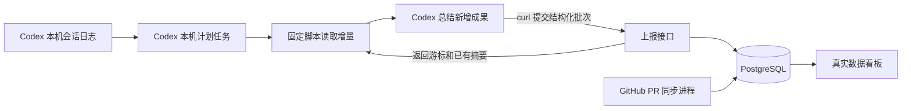

# Project Pulse 技术方案 v3

## 2026-11-16 上报闭环修订（包3.0.0／协议3）

- 项目cwd迁移：客户端仅使用已确认旧／新绝对路径映射，并核对真实Git remote、元数据与缓存；冲突列为待确认。映射保存在本机私有文件，分发包只含示例。服务端能力project_mapping_backfill允许同offset的mappings补报，仅更新本设备、本会话及其里程碑项目键，保留计量、读取游标与历史日志；有源会话作用域校验和幂等回执。旧服务端必须更新并重启，无需新数据库迁移。

- 采集范围首次固定为运行前7天，写入本地状态与服务端 cursor.context.report_from，后续积压不随时间过期。已知来源可从服务端目录恢复，轮转位置持久化。
- 文件头在整轮1 MiB预算内分段读取；排除依据明确会话ID和首条用户请求，不再匹配元数据内的指令文本。半行不推进游标，截断／损坏／超长行返回诊断。
- 会话内首个累计快照、正常差分、重复快照、累计值回退分别处理。跨范围初始快照及重置仅使用明确的last_token_usage；无法确定时报告unmeasured_snapshots，不猜测。
- 服务端事务回执返回用量条数和三类Token字符串，客户端逐项比较；Dashboard补充会话缓存输入。游标已推进但回执未核实时单独标记，不能宣称计量核验通过。
- 客户端保存待发目录并在下一轮优先重试同一请求；游标和事件ID维持幂等。协议目录提供本设备已知来源、能力和推荐版本，旧服务端明确拒绝，不静默降级。
- 用户确认的GitHub账号可在可信LAN模式匹配服务端已有成员（此为声明，不是GitHub认证）；共享仓库不作为成员依据。授权工作目录的本地Git remote用于规范项目键，未登记仓库先保留规范键。
- 自包含ZIP含版本、逐文件SHA256校验和和升级步骤，覆盖更新保留状态。定时设置与首次自动执行验收分别报告；仅有任务存在不能宣称自动运行验证通过。Windows／macOS固定脚本通过CI回归，PostgreSQL在独立临时库验证事务。

项目仓库：[jiawei-wang-dev/project-pulse](https://github.com/jiawei-wang-dev/project-pulse)

目前处于本机试点。正式看板读取 PostgreSQL。

## 1. 架构



客户端采集和总结上报、服务端 GitHub PR 同步的配置周期均为 **30 分钟**。试点已完成手动上报和手动 PR 同步。Windows 试点设备反馈已启用客户端定时任务，首次自动提交仍待验证。服务端 PR 同步按部署环境单独设置。服务端处理鉴权、校验、存储和查询。总结由成员机器上选定的工具发起，模型推理位置取决于该工具的配置。

## 2. 采集、命名与归属

- Codex 读取授权的 JSONL 日志，按原生线程 UUID 和字节偏移增量处理。游标保存在 PostgreSQL，与报告同时提交。
- 成员与设备使用 UUID。每台设备绑定一名成员，显示名由管理员登记。本机试点采用 GitHub 显示名。管理员通过 GitHub 用户名登记设备。服务端查到数字用户 ID 后自动复用成员 UUID。已有成员可指定 UUID 绑定并保留历史。按成员统计 PR 尚待实现。
- 会话使用原生 UUID，Agent、摘要和 Token 事件使用来源标识与日志位置派生稳定 UUID。服务端用设备 ID 限定归属。
- 项目列优先展示已匹配的 GitHub 仓库，其次使用会话工作目录的文件夹名。Git 归属来自会话远端信息或工作目录的 Git remote。完整路径留在本机。文件夹名用于展示，仓库关联用于 PR 和项目状态汇总。
- 可选读取 Codex 侧栏标题。看板优先显示独立保存的任务名称，再回退到会话原始标题。试点的短标题是手动补录，自动提炼待实现。
- Codex 子 Agent 在父线程可解析时归入根会话。子线程累计用量暂缓入账，避免继承历史重复计数。Claude Code 子 Agent 尚未接入。

## 3. 快速上报与摘要

- [快速上报包说明](ops/report/README.md) 提供 macOS 系统 Perl 和 Windows PowerShell 脚本。两端用系统 curl，按需运行。快速脚本覆盖 Codex 主会话，Claude Code、子 Agent 和历史里程碑补报按相应的 Markdown 上报协议处理。
- Prepare 查询服务端游标，逐字节读取新增完整行，计算 Token 增量并输出待提交计划。候选按最近 7 天的文件修改时间筛选，Token 按事件时间筛选。每轮最多检查 8 个文件，文件头和增量合计不超过 1 MiB，扫描预算约 12 秒，单个 HTTP 请求超时 4 秒。此预算不含摘要生成和提交。超预算的日志留待后续轮次处理。
- Codex 只在有新成果、验证或阻塞时更新摘要。先读取服务端已有摘要，再结合本轮脱敏证据。首次发现项目、缺少项目报告或目标有实质变化时，写一句目标和 1–12 条里程碑。仅在确认当前任务无法继续且没有可行替代路径时标记阻塞。
- Submit 校验批次回执。临时目录只保存本轮待提交计划、摘要和请求正文，提交成功后清理。失败时可复用同一个请求，或根据服务端确认的游标续跑。长期保存的读取位置、Token 基线和摘要在 PostgreSQL。
- 同事发送说明开头的授权提示词，先试报，成功后启用每 30 分钟的本机任务。已有同用途任务就更新。任务正文只执行一轮增量上报。确认任务已启用与验证首次自动提交是两项独立检查。

## 4. 上报协议 v1

`POST /api/v1/reports` 接收 UTF-8 JSON，每批最多 100 条记录，未压缩 JSON 上限 256 KiB，时间采用 UTC。标准入口从 Bearer 设备令牌解析身份，局域网试点入口可用 `X-Pulse-LAN-Device`。以下是示例，其中 `title` 和 `workspace_name` 可省略。

```json
{
  "schema_version": 1,
  "batch_id": "3de7b320-3e09-40a5-900c-f5f84309da4a",
  "sent_at": "2026-11-13T09:30:00Z",
  "collector_version": "1.0.0",
  "summaries": [{
    "summary_id": "da1940f4-0c7e-4f90-9c7d-4c2645444f83",
    "session_id": "9584a30d-f21b-4326-aab1-8dbb942063ef",
    "observed_at": "2026-11-13T09:20:00Z",
    "summary": "完成状态同步接口调整，依赖服务暂不可用。",
    "summarizer_tool": "claude_code",
    "prompt_version": "1.0.0"
  }],
  "sessions": [{
    "session_id": "9584a30d-f21b-4326-aab1-8dbb942063ef",
    "tool": "codex",
    "title": "调整课程检索",
    "workspace_name": "web",
    "revision": 12,
    "repository": "monashmate/web",
    "started_at": "2026-11-13T09:00:00Z",
    "last_activity_at": "2026-11-13T09:20:00Z",
    "project_observation": {
      "state": "blocked",
      "reason_code": "dependency_unavailable",
      "observed_at": "2026-11-13T09:20:00Z"
    }
  }],
  "agents": [{
    "agent_id": "f820dfcf-284c-4da1-8ce3-bdd652e69c93",
    "session_id": "9584a30d-f21b-4326-aab1-8dbb942063ef",
    "parent_agent_id": null,
    "kind": "main",
    "role": null,
    "state": "running",
    "last_activity_at": "2026-11-13T09:20:00Z",
    "revision": 8
  }],
  "usage": [{
    "event_id": "8784c3fd-d91d-4143-98d2-6fa762200ab3",
    "session_id": "9584a30d-f21b-4326-aab1-8dbb942063ef",
    "agent_id": "f820dfcf-284c-4da1-8ce3-bdd652e69c93",
    "occurred_at": "2026-11-13T09:20:00Z",
    "provider": "openai",
    "model": "gpt-5.4",
    "accounting": "billable",
    "input_tokens": 18000,
    "cached_input_tokens": 5000,
    "output_tokens": 3100
  }]
}
```

可选数组 `quota` 也计入每批条数。每项包含 `account_key`、`limit_id`、`window_key`、`observed_at`、`window_minutes`、`used_percent` 和可空的 `resets_at`。Codex 额度适配器通过配置的账号 UUID 归属快照。

`projects` 保存本机 Codex/Claude 的项目总结，首次或有实质变化时由客户端填报，每项包含 `report_id`、`source_session_id`、`project_key`、`goal`、`milestones`、`observed_at`、`summarizer_tool` 和 `prompt_version`。`milestones` 为 1–12 项，每项包含 `title`、`state`（`completed`/`pending`）和 `evidence`。项目键用仓库全名或已授权会话的工作区名。完成项必须有实施及验证证据；只有请求、计划或草稿时标未完成。没有可信证据时不伪造完成项。

相同批次 ID 与请求摘要返回原提交状态。相同 ID 内容不同返回 409。快照按 revision 更新，旧快照不会覆盖新状态，合法的未入库事件仍可写入。摘要和用量事件按各自的 ID 去重。提交成功返回 `batch_id` 和 `status: committed`。

直报先调用 `GET /api/v1/report-cursor?source_id=<线程UUID>`，沿用同一设备身份。响应含 `offset`、`context`、登记仓库列表、上一版摘要、主 Agent 状态和已有项目报告。首次返回偏移 0。提交时加 `cursor: {source_id, from_offset, to_offset, context}`，详细字段见上报提示词。服务端只接受与已提交位置连续的批次。写入失败时游标回滚。提交成功返回 `to_offset`。已上报的主会话缺少里程碑时，可在当前非零游标提交只含 `projects` 的批次，起止偏移相同，用量和游标保持原值。

## 5. PostgreSQL 与查询

| 数据表 | 职责 |
|---|---|
| developers、devices | 成员、设备、凭证摘要、撤销状态和最后同步时间 |
| github_identities | GitHub 数字用户 ID 与成员 UUID 的一对一绑定 |
| tools | 已登记的会话来源和总结工具 |
| repositories、project_milestones | 已登记仓库、业务分类、PR 游标和项目节点 |
| sessions、agents | 会话快照、原标题、展示标题、工作区名及 Agent 父子关系 |
| session_summaries | 摘要、观测时间、总结工具和提示词版本 |
| project_reports | 项目目标、已完成/未完成里程碑及简短依据的版本化快照 |
| usage_events、quota_snapshots、provider_accounts | 按事件记录 Token、按账号保存额度快照 |
| report_cursors | 每台设备各线程的成功偏移及 Token 基线 |
| ingest_batches、pull_requests | 批次幂等凭据和 GitHub PR 数据 |

迁移按 [001](db/001_init.sql)、[002](db/002_session_title.sql)、[003](db/003_session_display_title.sql)、[004](db/004_session_workspace.sql)、[005](db/005_project_reports.sql)、[006](db/006_report_cursors.sql)、[007](db/007_github_identities.sql) 的顺序应用。本机脚本会初始化空库并补齐后续字段。写入在同一事务执行，复合外键限制会话、父 Agent 和用量归属。

`GET /api/v1/dashboard?days=1|7|30` 统一按 **Asia/Singapore（UTC+8）** 的自然日筛选。今天从新加坡零点开始，近 7 天和近 30 天含今天。所有设备的时间戳仍用 UTC 入库。运行中 Agent 指最近一次上报仍为运行中且最后活动在 60 分钟内的记录。

Token 按事件时间统计输入与输出，缓存输入已包含在输入中。直报用相邻累计快照计算增量，首次无可信单次用量时只建立基线。

## 6. GitHub 产出

登记仓库后用服务器配置的 GitHub 凭证运行 `npm run sync:prs`。首轮读取每个仓库最新创建的 100 条 PR，后续按更新时间增量读取并保留重叠窗口。只在成功写入后推进仓库游标。看板按仓库分组展示 PR、草稿数和 GitHub 链接。私有 PR 的浏览权限由 GitHub 控制。

已在私有仓库用 [草稿 PR #1](https://github.com/jiawei-wang-dev/project-pulse/pull/1) 验证 GitHub 到 PostgreSQL 再到看板接口的链路。会话与具体 PR 的关联仍需分支、提交 SHA 或明确链接作为依据。

## 7. 部署与验收

- 本机运行 `npm ci` 后执行 `./ops/local.sh serve`。本机看板在回环地址的 4185 端口免登录访问。PostgreSQL 端口保留回环绑定。
- 可信局域网试跑用 `./ops/local.sh serve-lan <本机私有 IPv4>`，分发 [单文件上报说明](docs/lan-report.md) 或双平台快速上报包。此入口仅提供上报、游标和团队目录 API，使用 HTTP 明文。设备哈希用于区分和续报。目录提供成员、已观测项目和仓库链接；匹配 GitHub 用户名后可用成员显示名，其他情况可用 GitHub 或本机账号名。免令牌设备仍独立计量。
- 正式部署采用 HTTPS 和可撤销的每设备令牌，管理员可用 GitHub 数字用户 ID 为同一成员归并多台电脑。部署和数据迁移见 [README](README.md)。
- 已验证 PostgreSQL 集成测试、真实会话手动直报、草稿 PR 同步、备份恢复，以及 macOS 测试日志的首次、无增量、续报和重复提交。待验证 Windows 连续两轮增量和空跑、两端首次自动提交、完整耗时与资源占用、断网恢复和跨新加坡午夜统计。
