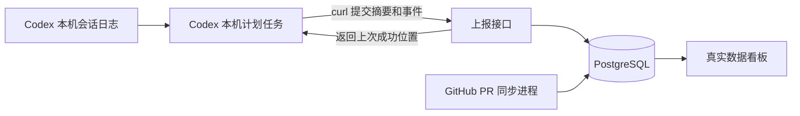

# Project Pulse 技术方案 v2

项目仓库：[jiawei-wang-dev/project-pulse](https://github.com/jiawei-wang-dev/project-pulse)

目前处于本机试点。正式看板读取 PostgreSQL。

## 1. 架构



客户端采集和总结上报、服务端 GitHub PR 同步的配置周期均为 **30 分钟**。试点完成了手动上报和手动 PR 同步。定时任务需要配置并验收。服务端处理鉴权、校验、存储和查询。总结由成员机器上选定的工具发起，模型推理位置取决于该工具的配置。

## 2. 采集、命名与归属

- Codex 读取授权的 JSONL 日志，按原生线程 UUID 和字节偏移增量处理。游标保存在 PostgreSQL，与报告同时提交。
- 成员与设备使用 UUID。每台设备绑定一名成员，显示名由管理员登记。本机试点采用 GitHub 显示名。管理员通过 GitHub 用户名登记设备。服务端查到数字用户 ID 后自动复用成员 UUID。已有成员可指定 UUID 绑定并保留历史。按成员统计 PR 尚待实现。
- 会话使用原生 UUID，Agent、摘要和 Token 事件使用来源标识与日志位置派生稳定 UUID。服务端用设备 ID 限定归属。
- 项目列优先展示已匹配的 GitHub 仓库，其次使用会话工作目录的文件夹名。Git 归属来自会话远端信息或工作目录的 Git remote。完整路径留在本机。文件夹名用于展示，仓库关联用于 PR 和项目状态汇总。
- 可选读取 Codex 侧栏标题。看板优先显示独立保存的任务名称，再回退到会话原始标题。试点的短标题是手动补录，自动提炼待实现。
- Codex 子 Agent 在父线程可解析时归入根会话。子线程累计用量暂缓入账，避免继承历史重复计数。Claude Code 子 Agent 尚未接入。

## 3. 会话摘要

Codex 使用 [上报提示词](prompts/report.md) 读取有限的本机证据，提炼实际工作、验证结果和项目里程碑。仅在当前任务无法继续且没有可行替代路径时，标记为阻塞。设备令牌与服务地址存于当前用户的本机配置。macOS 用系统命令处理并通过 curl 提交，Windows 用 PowerShell 处理并通过 curl.exe 提交。两端共用 UTF-8 JSON、字节游标和身份协议。服务端负责存储与展示。

## 4. 上报协议 v1

`POST /api/v1/reports` 使用设备 Bearer 令牌和 JSON 请求体。每批最多 100 条记录，未压缩 JSON 上限 256 KiB。时间采用 UTC，设备身份从令牌取得。以下是示例，其中 `title` 和 `workspace_name` 可省略。

```json
{
  "schema_version": 1,
  "batch_id": "3de7b320-3e09-40a5-900c-f5f84309da4a",
  "sent_at": "2026-11-13T09:30:00Z",
  "collector_version": "1.0.0",
  "summaries": [{
    "summary_id": "da1940f4-0c7e-4f90-9c7d-4c2645444f83",
    "session_id": "9584a30d-f21b-4326-aab1-8dbb942063ef",
    "observed_at": "2026-11-13T09:20:00Z",
    "summary": "完成状态同步接口调整，依赖服务暂不可用。",
    "summarizer_tool": "claude_code",
    "prompt_version": "1.0.0"
  }],
  "sessions": [{
    "session_id": "9584a30d-f21b-4326-aab1-8dbb942063ef",
    "tool": "codex",
    "title": "调整课程检索",
    "workspace_name": "web",
    "revision": 12,
    "repository": "monashmate/web",
    "started_at": "2026-11-13T09:00:00Z",
    "last_activity_at": "2026-11-13T09:20:00Z",
    "project_observation": {
      "state": "blocked",
      "reason_code": "dependency_unavailable",
      "observed_at": "2026-11-13T09:20:00Z"
    }
  }],
  "agents": [{
    "agent_id": "f820dfcf-284c-4da1-8ce3-bdd652e69c93",
    "session_id": "9584a30d-f21b-4326-aab1-8dbb942063ef",
    "parent_agent_id": null,
    "kind": "main",
    "role": null,
    "state": "running",
    "last_activity_at": "2026-11-13T09:20:00Z",
    "revision": 8
  }],
  "usage": [{
    "event_id": "8784c3fd-d91d-4143-98d2-6fa762200ab3",
    "session_id": "9584a30d-f21b-4326-aab1-8dbb942063ef",
    "agent_id": "f820dfcf-284c-4da1-8ce3-bdd652e69c93",
    "occurred_at": "2026-11-13T09:20:00Z",
    "provider": "openai",
    "model": "gpt-5.4",
    "accounting": "billable",
    "input_tokens": 18000,
    "cached_input_tokens": 5000,
    "output_tokens": 3100
  }]
}
```

可选数组 `quota` 也计入每批条数。每项包含 `account_key`、`limit_id`、`window_key`、`observed_at`、`window_minutes`、`used_percent` 和可空的 `resets_at`。Codex 额度适配器通过配置的账号 UUID 归属快照。

可选数组 `projects` 保存本机 Codex/Claude 的项目总结，每项包含 `report_id`、`source_session_id`、`project_key`、`goal`、`milestones`、`observed_at`、`summarizer_tool` 和 `prompt_version`。`milestones` 为 1–12 项，每项包含 `title`、`state`（`completed`/`pending`）和 `evidence`。项目键用仓库全名或已授权会话的工作区名。完成项必须有实施及验证证据；只有请求、计划或草稿时标未完成。没有可信证据时不伪造完成项。

相同批次 ID 与请求摘要返回原提交状态。相同 ID 内容不同返回 409。快照按 revision 更新，旧快照不会覆盖新状态，合法的未入库事件仍可写入。摘要和用量事件按各自的 ID 去重。提交成功返回 `batch_id` 和 `status: committed`。

直报先调用 `GET /api/v1/report-cursor?source_id=<线程UUID>`，使用同一个设备令牌。响应含 `offset`、`context` 和登记仓库列表。首次返回偏移 0。提交时加 `cursor: {source_id, from_offset, to_offset, context}`，详细字段见上报提示词。服务端只接受与已提交位置连续的批次。写入失败时游标回滚。提交成功返回 `to_offset`。

## 5. PostgreSQL 与查询

| 数据表 | 职责 |
|---|---|
| developers、devices | 成员、设备、凭证摘要、撤销状态和最后同步时间 |
| github_identities | GitHub 数字用户 ID 与成员 UUID 的一对一绑定 |
| tools | 已登记的会话来源和总结工具 |
| repositories、project_milestones | 已登记仓库、业务分类、PR 游标和项目节点 |
| sessions、agents | 会话快照、原标题、展示标题、工作区名及 Agent 父子关系 |
| session_summaries | 摘要、观测时间、总结工具和提示词版本 |
| project_reports | 项目目标、已完成/未完成里程碑及简短依据的版本化快照 |
| usage_events、quota_snapshots、provider_accounts | 按事件记录 Token、按账号保存额度快照 |
| report_cursors | 每台设备各线程的成功偏移及 Token 基线 |
| ingest_batches、pull_requests | 批次幂等凭据和 GitHub PR 数据 |

迁移按 [001](db/001_init.sql)、[002](db/002_session_title.sql)、[003](db/003_session_display_title.sql)、[004](db/004_session_workspace.sql)、[005](db/005_project_reports.sql)、[006](db/006_report_cursors.sql)、[007](db/007_github_identities.sql) 的顺序应用。本机脚本会初始化空库并补齐后续字段。写入在同一事务执行，复合外键限制会话、父 Agent 和用量归属。

`GET /api/v1/dashboard?days=1|7|30` 统一按 **Asia/Singapore（UTC+8）** 的自然日筛选。今天从新加坡零点开始，近 7 天和近 30 天含今天。所有设备的时间戳仍用 UTC 入库。运行中 Agent 指最近一次上报仍为运行中且最后活动在 60 分钟内的记录。

Token 按事件时间统计输入与输出，缓存输入已包含在输入中。直报用相邻累计快照计算增量，首次无可信单次用量时只建立基线。

## 6. GitHub 产出

登记仓库后用服务器配置的 GitHub 凭证运行 `npm run sync:prs`。首轮读取每个仓库最新创建的 100 条 PR，后续按更新时间增量读取并保留重叠窗口。只在成功写入后推进仓库游标。看板按仓库分组展示 PR、草稿数和 GitHub 链接。私有 PR 的浏览权限由 GitHub 控制。

已在私有仓库用 [草稿 PR #1](https://github.com/jiawei-wang-dev/project-pulse/pull/1) 验证 GitHub 到 PostgreSQL 再到看板接口的链路。会话与具体 PR 的关联仍需分支、提交 SHA 或明确链接作为依据。

## 7. 部署、验证与推广顺序

- 本机运行 `npm ci` 后执行 `./ops/local.sh serve`。访问 http://127.0.0.1:4185/，看板仅绑定回环地址并免登录。设备上报仍使用可撤销的令牌。数据库和凭证留在本机。配置说明见 [README](README.md)。
- 团队试点时部署 HTTPS 入口，为每台设备独立签发令牌。共享部署的看板支持访问令牌，个人登录取决于实际访问需要。
- 已验证 38 项测试、PostgreSQL 合成会话集成测试、本机真实日志与摘要入库、草稿 PR 同步及备份恢复。
- 优先修正 Token 基线并验收跨新加坡午夜。然后配置两个 30 分钟定时任务，实测增量采集、无新活动、断网补传、凭证撤销和重复上报。
- 增加第二台开发机和私有仓库试点，验证身份归属与性能。直报提示词把新读数据限制为每轮 1 MiB。CPU、内存和对构建的影响仍需实测。
- 将真实数据接回已确认的多页面 UI。推广前补齐安装升级流程、同步失败与设备缺报提醒，以及定期备份和恢复演练。
